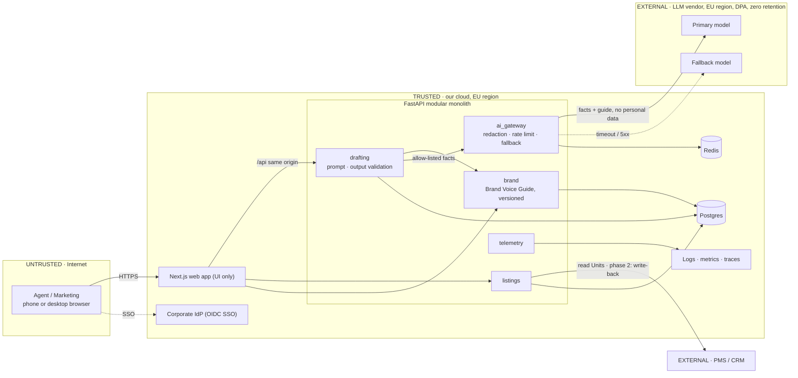

# Part B — Architecture & Design

Target solution for the pilot and the 40,000-Unit multi-country rollout; Part C builds a thin slice of it. Vocabulary: `GLOSSARY.md`.

## System diagram

**Flow:** facts → `drafting` builds the prompt from an allow-listed DTO plus the current Brand Voice Guide → `ai_gateway` redacts, rate-limits and calls the model → output is validated (schema + brand rules); on failure there is one retry with the errors, then fail closed → the Agent edits and approves → the Listing Description is stored with approver and guide version.

**Trust boundaries:** (1) browser → API: all input is validated, sessions come from SSO. (2) API → LLM vendor: the only outbound AI path, with no personal data (ADR 0003). (3) API ↔ PMS: read-only in the pilot.

**Pilot → rollout:** the pilot runs in one EU region with one office, facts typed by Agents and copy-paste publishing. Rollout adds PMS sync and write-back (I1), RBAC by country/office, a Brand Voice Guide section and an eval set per language (text is generated natively, never translated), and one deployment cell per residency region if non-EU markets require it. Volume: 40k Units × ~30% yearly turnover × ~3 generations is about 100 model calls a day. Load does not drive the design; compliance, quality and cost do.

## ADRs
[0001 Modular monolith](adr/0001-modular-monolith.md) · [0002 Swappable AI provider](adr/0002-swappable-ai-provider.md) · [0003 Compliance boundary](adr/0003-compliance-boundary.md)

## Patterns
- **Ports & Adapters for the LLM**: the vendor is the most likely thing to change; the domain never imports an SDK.
- **Service layer** (`DraftService`): domain logic is testable without HTTP or network.
- **DTO + schema validation at every boundary**: the browser and the model are both untrusted input.
- **Config-as-data for the Brand Voice Guide**: Marketing changes tone without a deploy; one source for prompt and validator.
- **Facade** (`ai_gateway`): redaction, rate limits, fallback and cost logging live in one place.
- **Deliberately not:** no Repository for Listings in the slice (one in-memory implementation; it arrives with Postgres/PMS), no Strategy per language (it's a prompt parameter), no queue (~100 calls a day).

## Cross-cutting concerns
| Concern | Approach |
|---|---|
| Privacy & GDPR | Only Unit facts, Deal Type, price, language and the guide reach the model. Notes pass PII redaction. The Agent's identity stays in our cloud. EU inference, DPA, zero retention. Prompts are not logged; Drafts sit in our EU DB under a retention policy. |
| Prompt injection | Internal users and typed fields; notes are length-limited and delimited as data. The model has no tools, only an output schema, so the worst case is bad text a human reviews. Prospect Q&A (phase 2) needs stronger guards. |
| Hallucination & quality | Facts-only instruction; the validator cross-checks numbers against the input. An offline eval harness (golden fact sets, rule checks, LLM-judge rubric) runs in CI on every prompt, guide or model change. Live signals: edit rate, approval rate, regenerations. |
| Brand voice & HITL | Versioned guide owned by Marketing; banned phrases and length checked deterministically, tone by the judge. Nothing is published without Approve. |
| Cost & performance | Provider prompt caching of the static guide, per-Agent and global rate limits, daily budget alert, small model by default. Timeout → fallback model → clear error; the Agent can always write manually. |
| Observability | Per call: request id, pseudonymous Agent id, model, prompt and guide version, tokens, cost, latency, validation outcome, retries. Events: generated, edited, approved, edit distance. Alerts on error rate, p95, validation-failure spikes, daily cost, edit-rate drift per language. |

## Team & delivery
Dev 1: backend core (`drafting`, validation, `ai_gateway`). Dev 2: frontend and mobile UX. Dev 3: platform (SSO, EU hosting, CI, observability). Dev 4: prompts and eval harness with Marketing. First comes a thin end-to-end path against the real model, so Marketing reviews real Drafts from week 2.
